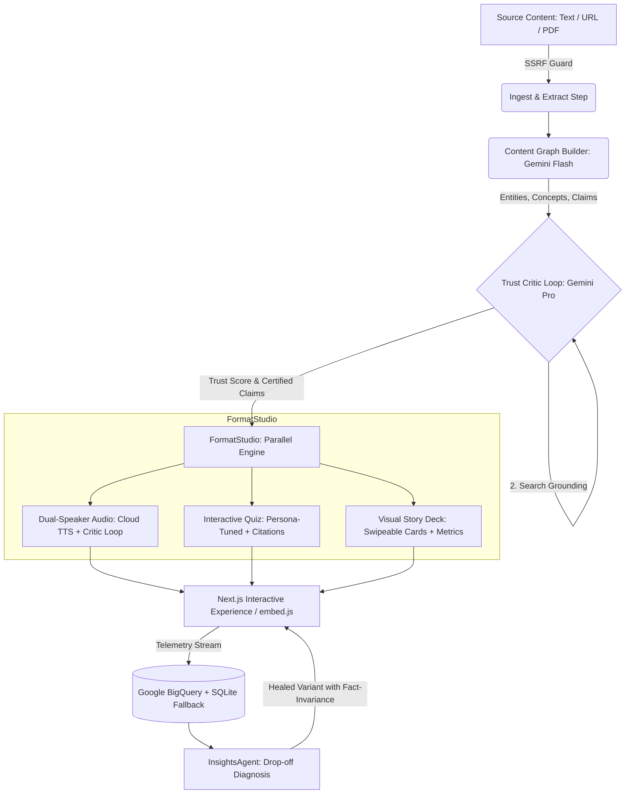

# Kaleido 🔮
> **One source, a verified experience for every audience.**
> An end-to-end multi-format personalization and fact-invariant verification platform powered by Vertex AI Gemini, Cloud Text-to-Speech, and BigQuery.

[](https://fastapi.tiangolo.com)
[](https://nextjs.org)
[](https://cloud.google.com/vertex-ai)
[](LICENSE)

---

## 🌟 Overview

**Kaleido** solves a fundamental bottleneck in modern digital publishing: *the tension between tailored audience engagement and factual integrity.* 

Traditional automated personalization risks hallucination, bias, and factual drift. Kaleido guarantees **Fact Invariance**:
- You feed in a single authoritative source (article text, webpage URL, or PDF report).
- The engine decomposes the text into a structured **Content Graph** with atomic factual claims.
- A **Two-Stage Trust Critic** verifies faithfulness against the source and grounds claims against real-world truth.
- The **FormatStudio** concurrently synthesizes verified multi-format artifacts (Podcast-style dual-speaker audio briefings, interactive quizzes, and swipeable visual story decks).
- An **Audience Insights Agent** continuously monitors drop-off telemetry via **BigQuery** and heals high-friction sections with fact-invariant rewrites.
- Publishers can embed verified interactive experiences onto any external domain with a single `<script src="/embed.js">` tag.

---

## 🏗️ Architecture & Pipeline Flow



---

## ✨ Key Capabilities

### 1. Ingestion & SSRF Protection
- **Multi-Modal Ingestion**: Ingest raw text, live webpage URLs, or base64-encoded PDF documents.
- **Enterprise SSRF Guard**: Strict URL validation blocking loopback, private RFC-1918 subnets, link-local, multicast, and cloud metadata endpoints (`169.254.169.254`).

### 2. Verified Content Graph
- Extracts key entities (Person, Org, Tech, Metric), core thematic concepts, reading time, tone, and difficulty level.
- Deconstructs text into 4–8 atomic factual propositions mapped directly to source text spans.

### 3. Two-Stage Trust Critic & Vertex AI Search Grounding
- **Stage 1 (Source Faithfulness)**: Validates that each claim is faithfully asserted in the original document without editorial drift, exaggeration, or distortion.
- **Stage 2 (World Truth Grounding)**: Corroborates claims against live world knowledge using Vertex AI Gemini Pro armed with the Google Search tool (`types.Tool(google_search=types.GoogleSearch())`).
- **Live Grounding Metadata Extraction**: Directly parses `search_resp.candidates[0].grounding_metadata.grounding_chunks[].web.uri` to attach real web citations to verified propositions.
- **Scientific Factuality Protocol**:
  - Differentiates breakthrough research milestones (e.g. 99.85% two-qubit gate fidelity, 12x error suppression) as valid `VERIFIED` technical claims.
  - Flags physically impossible or scientifically debunked premises (e.g. room-temperature quantum computation with zero cooling infrastructure) as `CONTRADICTED` with thermodynamic evidence quotes.
- Produces a transparent **Trust Score (0–100%)** with per-claim citations, evidence cards, and audit trails.

### 4. Dual-Tier Caching & Deterministic Fingerprints
- **Deterministic SHA-256 Fingerprinting**: Fast in-memory L1 cache and persistent SQLite L2 cache (`content_cache`) return verified graphs in <10ms on repeat inputs.
- **Deterministic Audio Disk Caching**: Caches synthesized podcast files as `briefing_{audio_hash}.mp3`, eliminating redundant TTS quota usage and synthesis latency.

### 5. Parallel FormatStudio
- **Neural Audio Briefing**: Produces a podcast-style dialogue between a Host and an Analyst.
  - Writer-Critic validation loop harmonizes turns to prevent unverified drift.
  - High-fidelity dual-speaker neural audio synthesis via `edge-tts` (Microsoft Neural voices: `en-US-GuyNeural` & `en-US-JennyNeural`, `hi-IN-MadhurNeural` & `hi-IN-SwaraNeural`, `mr-IN-AarohiNeural`).
  - Seamless in-browser Web Speech API (`window.speechSynthesis`) fallback with alternating pitch to ensure audio always plays without interruption.
  - Synchronized dialogue timestamps and real-time highlighted turns.
- **Interactive Quiz**: Persona-tuned comprehension questions (Student vs. Executive) with immediate feedback and citations directly tied to verified claims.
- **Visual Story Deck**: High-impact cards with bold metric callouts, takeaways, and categorical badges.

### 5. Closed-Loop Telemetry & Self-Healing Insights
- Streaming telemetry recorded in **Google Cloud BigQuery** (`team-gain.kaleido_analytics.reader_events`) with local asynchronous SQLite fallback.
- **InsightsAgent** identifies engagement drop-offs, diagnoses friction causes, and auto-generates optimized rewrites certified for 100% fact-invariance.

### 6. Publisher Embed & Metering
- Standalone `/embed.js` distribution script with cryptographic provenance headers.
- Built-in live sandbox generator and publisher credit consumption metering.

---

## 📁 Repository Structure

```text
Kaleido/
├── backend/
│   ├── agents/
│   │   ├── audio_pipeline.py       # Dual-speaker TTS generator with writer-critic loop
│   │   ├── chat_agent.py           # Grounded Q&A assistant for verified claims
│   │   ├── format_studio.py        # Parallel synthesis of Quiz & Story Cards
│   │   ├── ingest_pipeline.py      # SSRF-protected ingestion & Graph extraction
│   │   ├── insights_agent.py       # Telemetry diagnosis & variant self-healing
│   │   ├── trust_pipeline.py       # Two-stage source faithfulness & search grounding
│   │   └── workflow_engine.py      # ADK primitives (Sequential, Parallel, Loop)
│   ├── api/
│   │   ├── router.py               # Aggregated APIRouter
│   │   └── routes/
│   │       ├── analytics.py        # Telemetry, insights, optimization, metering
│   │       ├── content.py          # Ingest, jobs, SSE streaming, audio, chat
│   │       ├── health.py           # Engine health check
│   │       └── samples.py          # Golden demo seed samples
│   ├── core/
│   │   ├── config.py               # Central environment, GCP & TTS settings
│   │   └── database.py             # SQLite connection manager & automated migrations
│   ├── db/
│   │   └── repositories/
│   │       └── job_repository.py   # Dedicated JobStatus persistence
│   ├── models/
│   │   └── schemas.py              # Pydantic data schemas
│   ├── services/
│   │   ├── bigquery_service.py     # BigQuery telemetry streaming & SQLite fallback
│   │   ├── demo_seeds.py           # Curated demo articles (Quantum, Climate)
│   │   └── job_manager.py          # Pipeline runner & SSE broadcasting
│   ├── static/
│   │   ├── audio/                  # Synthesized MP3 briefings
│   │   └── embed.js                # Standalone publisher widget script
│   ├── utils/
│   │   └── json_parser.py          # Shared LLM JSON cleaner & extractor
│   ├── tests/                      # Full Pytest test suite & E2E integration test
│   ├── config.py                   # Backward-compatibility alias
│   └── main.py                     # Lean FastAPI application entry point
│
├── frontend/
│   ├── src/
│   │   ├── app/
│   │   │   ├── globals.css         # Dark-mode styling
│   │   │   ├── layout.tsx          # Root Next.js layout
│   │   │   └── page.tsx            # Main application dashboard
│   │   ├── components/
│   │   │   ├── AudioPlayer.tsx     # Synchronized multi-speaker player
│   │   │   ├── ContentGraphView.tsx# Graph visualizer & grounded Q&A
│   │   │   ├── EmbedSandboxModal.tsx # Publisher widget playground
│   │   │   ├── InsightsDrawer.tsx  # Audience drop-off diagnostics & self-healing
│   │   │   ├── PersonaComparisonModal.tsx # Fact-invariance comparison matrix
│   │   │   ├── QuizWidget.tsx      # Interactive verified quiz
│   │   │   ├── StoryCardDeck.tsx   # Swipeable visual story cards
│   │   │   └── TrustInspector.tsx  # Deep claim verification audit modal
│   │   ├── services/
│   │   │   └── api.ts              # Strongly-typed HTTP API client
│   │   └── types/
│   │       └── index.ts            # Synchronized TypeScript interfaces
│   ├── package.json
│   └── tsconfig.json
│
├── PLAN.md                         # Product specification & architectural design
├── package.json                    # Root workspace script definitions
├── pytest.ini                      # Pytest asynchronous configuration
└── README.md                       # Platform documentation
```

---

## 🚀 Getting Started

### Prerequisites
- **Python 3.11+**
- **Node.js 18+** and **npm**
- **Google Cloud Platform Project** with Application Default Credentials (ADC):
  ```bash
  gcloud auth application-default login
  ```
- *Optional APIs*: Vertex AI API, Cloud Text-to-Speech API, BigQuery API.

---

### 1. Backend Setup

```bash
# Navigate to backend directory
cd backend

# Create and activate virtual environment
python -m venv .venv
# Windows PowerShell:
.\.venv\Scripts\Activate.ps1
# macOS/Linux:
source .venv/bin/activate

# Install dependencies
pip install -r requirements.txt

# Start the FastAPI server
uvicorn backend.main:app --port 8000 --reload
```
The backend API is now running at `http://localhost:8000`. You can inspect interactive Swagger documentation at `http://localhost:8000/docs`.

---

### 2. Frontend Setup

```bash
# In a new terminal, navigate to frontend directory
cd frontend

# Install dependencies
npm install

# Start the Next.js development server
npm run dev
```
Open [http://localhost:3000](http://localhost:3000) to view the Kaleido dashboard.

---

## 🧪 Testing & Verification

Kaleido includes comprehensive unit tests and automated end-to-end integration verification:

### Run Complete Backend Test Suite (20/20 Passed)
```bash
pytest backend/tests/ -v
```

### Run Audio & Trust Critic Upgrades Test Specifically
```bash
pytest backend/tests/test_audio_and_trust_upgrades.py -v
```
*Validates*: High-fidelity neural audio synthesis via `edge-tts` (>10KB valid MP3) + Vertex AI Google Search Grounding with contradiction detection.

### Run End-to-End Pipeline Job Test
```bash
pytest backend/tests/test_end_to_end.py -v
```
*Validates*: Health check -> SSRF Ingestion -> Content Graph Extraction -> Grounded Trust Critic -> Multi-Speaker Audio -> Interactive Quiz -> Story Cards -> BigQuery / SQLite Telemetry.

### Run Frontend Production Build
```bash
npm --prefix frontend run build
```

---

## 🔌 API Reference

| Method | Endpoint | Description |
| :--- | :--- | :--- |
| `GET` | `/api/health` | Service health, active GCP project, and configured models. |
| `GET` | `/api/samples` | List curated 1-click golden demo articles. |
| `GET` | `/api/samples/{id}` | Retrieve specific sample article by ID. |
| `POST` | `/api/ingest` | Initiates asynchronous ingestion pipeline job. |
| `GET` | `/api/jobs/{job_id}` | Query current job status, pipeline progress, and generated artifacts. |
| `GET` | `/api/jobs/{job_id}/stream` | Server-Sent Events (SSE) real-time pipeline event stream. |
| `GET` | `/api/audio/{filename}` | Serve synthesized MP3 audio briefing. |
| `POST` | `/api/chat` | Verified claim-grounded Q&A chat. |
| `POST` | `/api/events` | Record reader interaction telemetry to BigQuery / SQLite. |
| `GET` | `/api/insights/{job_id}` | Run InsightsAgent drop-off analysis. |
| `POST` | `/api/optimize-variant` | Generate fact-invariant optimized section rewrite. |
| `GET` | `/api/metering` | Retrieve publisher audience metrics and cost economics. |
| `GET` | `/embed.js` | Serve standalone publisher widget script with provenance header. |

---

## 🌐 Standalone Publisher Embed

Publishers can embed Kaleido verified briefings into any website:

```html
<!-- Include in any article or CMS page -->
<div id="kaleido-widget"></div>
<script 
  src="https://your-kaleido-domain/embed.js" 
  data-kaleido="job_fb9f236aef" 
  data-theme="dark"
  async>
</script>
```

---

## 🛡️ License

Distributed under the Apache 2.0 License. See `LICENSE` for details.
